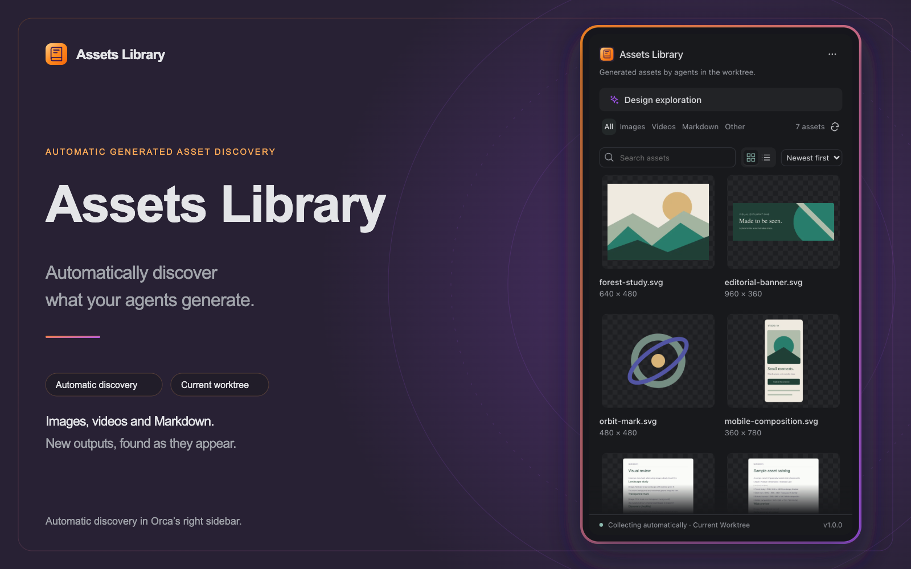
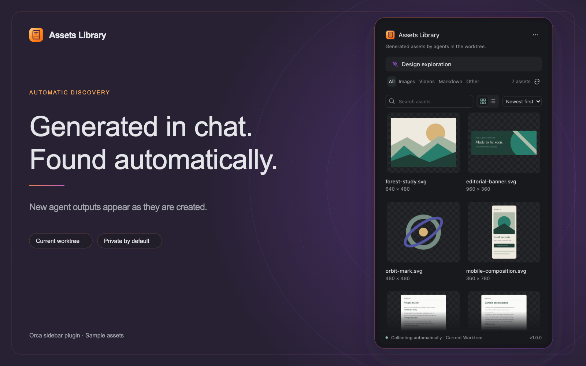
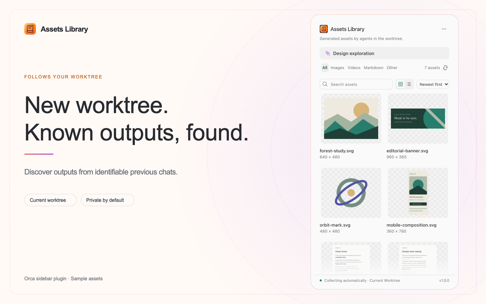
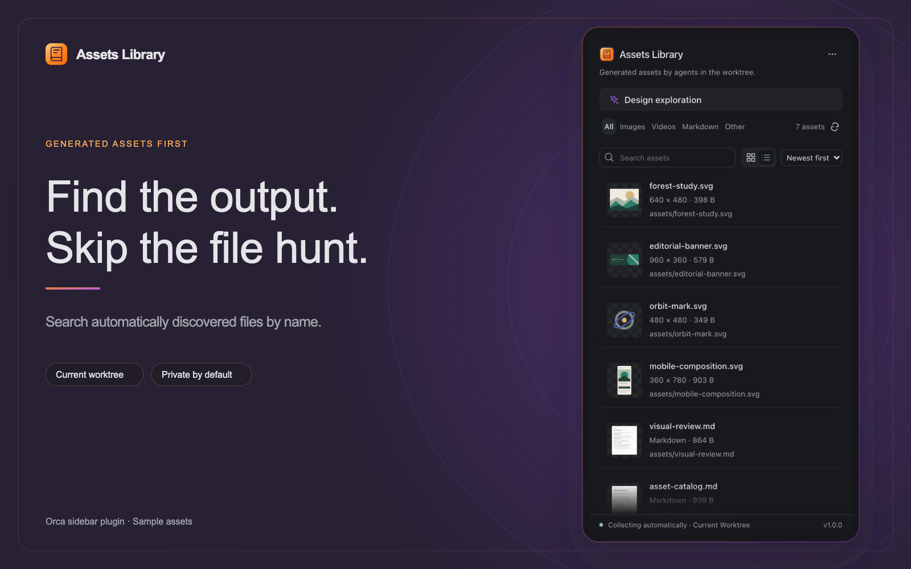
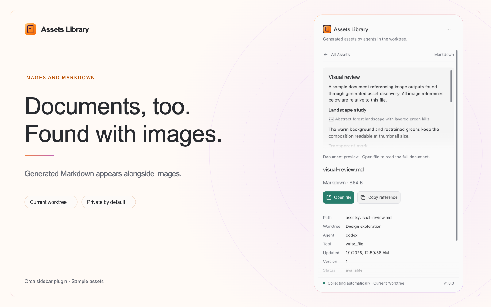

# Assets Library

**Discover what your agents generate.**

Assets Library automatically discovers images, videos, SVGs, Markdown and HTML generated inside the active worktree during agent conversations in [Orca](https://onorca.dev). New outputs appear as they are created, and switching worktrees recovers previously indexed files and outputs identified by recorded chat file-change evidence. You can find generated files without hunting through directories or asking an agent to register them.

  

Version **1.0.0**. See [CHANGELOG.md](CHANGELOG.md) and [RELEASE.md](RELEASE.md).

## Discover generated assets automatically

Library shows only generated outputs physically stored inside the active worktree. Ordinary repository images, videos and documents are never scanned or shown. Files need explicit agent/tool write, output or recorded file-change evidence. Orca’s separate chat-output folders are excluded.

- **During agent work:** structured write/output evidence identifies worktree outputs; filesystem watchers refresh files already attributed to agents.
- **When a worktree opens:** known records are refreshed, and recorded chat file-change paths recover supported outputs from earlier conversations.
- **While the sidebar is closed:** the enabled worker keeps discovering outputs and persists their paths and provenance privately.
- **When you switch worktrees:** the results follow the newly active worktree. Assets from unrelated worktrees stay out of the visible collection.

No special agent prompt, output convention or manual scan is needed where Orca exposes sufficient evidence. The worktree name at the top identifies the scope. New results appear with a brief fade and scale animation; discovery never forces the sidebar open or takes keyboard focus.

Supported files are **PNG, JPEG, WebP, GIF, SVG, AVIF, MP4, WebM, Markdown and HTML (.html/.htm)**. File signatures, container/video-track headers or validated UTF-8 text determine support, rather than extensions alone. Videos use Orca’s browser codecs for cached thumbnail frames and an HTML video player in Info. No decoder package is added. Codec support depends on the browser; unsupported files keep their type, size and Open action. Fonts and other video containers are deferred.

## How discovery identifies generated files

Assets Library uses structured write/output evidence where Orca provides it. A version-dependent, read-only worktree adapter recovers explicit file-change paths from Orca’s local journal, including previous chats, without retrieving prompts, messages or patch content. The optional workspace adapter uses Orca’s documented CLI inventory to map native session/workspace identities and activity; it never scans chat folders. Filesystem watchers refresh attributed files. Agent activity timing alone never adds repository files.

Only confirmed worktree outputs appear. Ordinary, timing-inferred and chat-folder records saved by earlier discovery versions are retired from the private index on startup. Original files are never moved or deleted.

Historical repository files without recorded evidence cannot universally be identified as generated and remain excluded. Files saved outside the worktree, including native chat-output folders, do not appear. Orca does not expose a reliable selected-chat filter or exact creation-message navigation API. See [COMPATIBILITY.md](COMPATIBILITY.md) and the [discovery integration matrix](docs/INTEGRATION.md).

## Recheck generated outputs on demand

Click the refresh icon to the right of **N assets** to recheck recorded worktree file-change paths and already attributed files. During automatic or manual discovery, **Refreshing** replaces the count and a loading indicator replaces the refresh icon. Results arrive progressively; the count and button return when discovery finishes. Refresh never inventories ordinary repository assets or chat-output folders. There is no generated/all-assets dropdown or broad filesystem discovery action.

The three-dot discovery settings menu controls excluded folders, supported extensions and file-size limits. No configuration is needed to begin collecting outputs. Generated assets are not discarded solely because Git ignores them. The default file-size limit is 32 MB, configurable from 1–64 MB, including for videos.

Unavailable files are hidden by default. Enable **Include unavailable files** in discovery settings to show previously collected assets whose originals are missing. This preference persists across restarts; hidden records retain their metadata.

Each canonical full file path, including its filename, appears once. Repeated events, refreshes and old duplicate index entries preserve one record and its strongest provenance. Identical contents at different paths remain separate assets.

## Find and open a discovered output

Use filename/path search, type filters and sorting to locate a result. Cards and List show the same generated outputs, and the layout preference persists. SVG and GIF belong to Images; MP4 and WebM belong to Videos.

Click a thumbnail, a list row or **Open** to open the original image, SVG, Markdown or video in Orca’s editor using a canonical worktree-relative path. HTML opens in Orca’s browser through its documented CLI local-file route. **Info** shows paths, metadata and previews inside the sidebar. Markdown has a compact, rendered, scrollable excerpt. HTML appears under **Other**, labeled **HTML**, with a compact source excerpt; scripts and linked resources never run inside Library. Info opens only when selected. No working copies or symlinks are created.

Arrow keys and Home/End navigate results, Tab reaches Open/Info, Escape returns from details or clears the search query, and Cmd/Ctrl+F focuses the always-visible search field. See [docs/USAGE.md](docs/USAGE.md) for discovery behavior, file actions and persistence.

## Install

Plugin ID: **assets-library**.

Requires **Orca desktop 1.4.257 or newer** and its compatible CLI. No separate Node.js installation or native image libraries are required. macOS Apple silicon has been exercised in desktop Orca; Apple silicon and Intel release checks are configured. Linux and Windows desktop behavior is not yet verified. Remote filesystems remain unsupported.

1. Open **Settings → Plugins → Add plugin → From a Git URL…**.
2. Enter the versioned repository URL:

       https://github.com/faisalmuhammad/orca-assets-library#v1.0.0

3. Review the trusted worker, workspace discovery and navigation, agent events, and plugin-owned storage access.
4. Open **Assets Library** from the book icon in the right sidebar. Automatic discovery runs while the plugin is enabled, including when the panel is closed.

The tagged repository includes the fully bundled worker and panel. No npm install or build is needed to use the release.

## Screenshots

| Automatic discovery · Dark | Active worktree · Light |
| --- | --- |
|  |  |

| Locate discovered files | Generated Markdown |
| --- | --- |
|  |  |

These screenshots render the compiled panel with controlled sample assets and an Orca bridge fixture. They illustrate discovery results and contain no personal workspace paths or conversation data. See [artwork provenance](assets/SCREENSHOTS.md).

## Discovery stays on your machine

| Access | Purpose |
| --- | --- |
| Trusted Node worker | Discover files within approved roots, check file headers, and call Orca’s CLI |
| workspace:read | Identify the active worktree and map native session identities |
| workspace:write | Open discovered repository files and native Explorer |
| agent:read | Receive agent lifecycle and structured tool evidence |
| storage:own | Persist discovery evidence, the asset index, preferences and bounded thumbnails |

Discovery works offline. Files, thumbnails and metadata stay on your machine; nothing is uploaded and no conversation text is indexed. Only identified worktree roots are inspected for assets. Escaping symlinks, dependency folders, caches and oversized or unsupported files are excluded.

The browser renders previews through private Blob URLs and creates small cached thumbnails on demand. SVG previews remove executable and external content. Markdown uses safe DOM nodes, omits raw HTML and does not load linked resources. Discovery and Info never execute files. Opening HTML explicitly renders the original in Orca’s browser. The private index is never written into your repository.

Development and release

Use Node.js 22+, npm, a compatible Orca CLI and Chromium:

    npm ci
    orca plugin types . --json
    npx playwright install chromium
    PLAYWRIGHT_CHANNEL=chromium npm run check

Use a compatible CLI through ORCA_CLI_COMMAND when needed. Building updates the committed runtime/ and prepares dist/plugin/. Register the plugin with:

    orca plugin dev load . --json

Publication assets live in assets/. Review images with **npm run release:art**. **npm run release:check** verifies versions, documentation, image budgets, absence of native runtime dependencies, package contents and private-text exclusions. Test captures and development state stay in ignored directories.

To prepare a release, update the manifest and changelog, run **npm run release:prepare** and the checks, then commit the prepared files. Successful pushes to main create the manifest version’s tag and GitHub release; pull requests and manual runs validate only. Existing releases are preserved. See [RELEASE.md](RELEASE.md).

## License

An unofficial community plugin maintained by [faisalmuhammad](https://github.com/faisalmuhammad). Plugin code and original artwork use [MIT](LICENSE). Bundled dependencies retain their own licenses; see [THIRD_PARTY_NOTICES.md](THIRD_PARTY_NOTICES.md).
