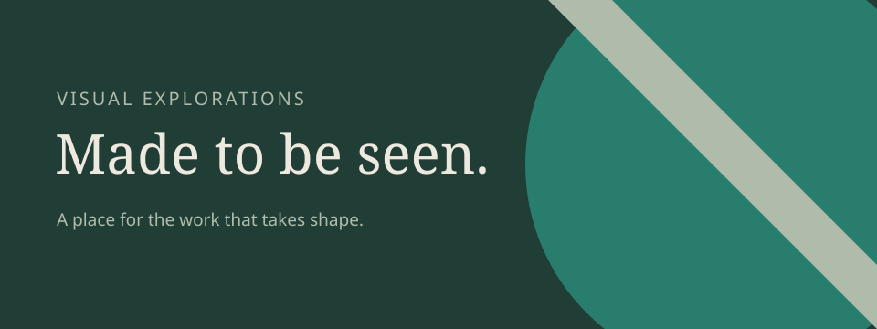

# Sample asset catalog

A sample record of generated assets and references to their original files. Assets Library discovers supported outputs automatically; this document is not required for discovery.

| Asset | Format | Dimensions | Intended use |
| --- | --- | --- | --- |
| [Forest study](./forest-study.svg) | SVG | 640 × 480 | Landscape illustration |
| [Orbit mark](./orbit-mark.svg) | SVG | 480 × 480 | Transparent identity mark |
| [Editorial banner](./editorial-banner.svg) | SVG | 960 × 360 | Wide composition |
| [Mobile composition](./mobile-composition.svg) | SVG | 360 × 780 | Tall interface study |

## Wide preview

## Referencing an asset

Copy a relative path from Assets Library, or use **Copy reference** to insert an image reference:

    

The original files stay in this folder. Assets Library stores its metadata privately.
