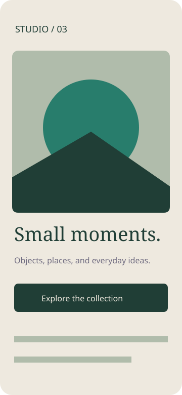

# Sample design notes

## Goal

Discover agent-generated images and documents automatically, without requiring users to scan folders or agents to register their outputs.

## Composition study

The tall fixture tests a different aspect ratio from the landscape and banner samples. A thumbnail should show the full composition without stretching it.

## Decisions

1. Keep generated outputs separate from existing project files.
2. Preserve aspect ratios in thumbnails.
3. Preserve attribution evidence in the private index.
4. Keep discovery of existing files an explicit action.

## Open questions

- How does the layout feel at 240 pixels wide?
- Is the filename easy to distinguish from the path?
- Can every primary action be reached with the keyboard?

> This document is an illustrative sample for Assets Library.
